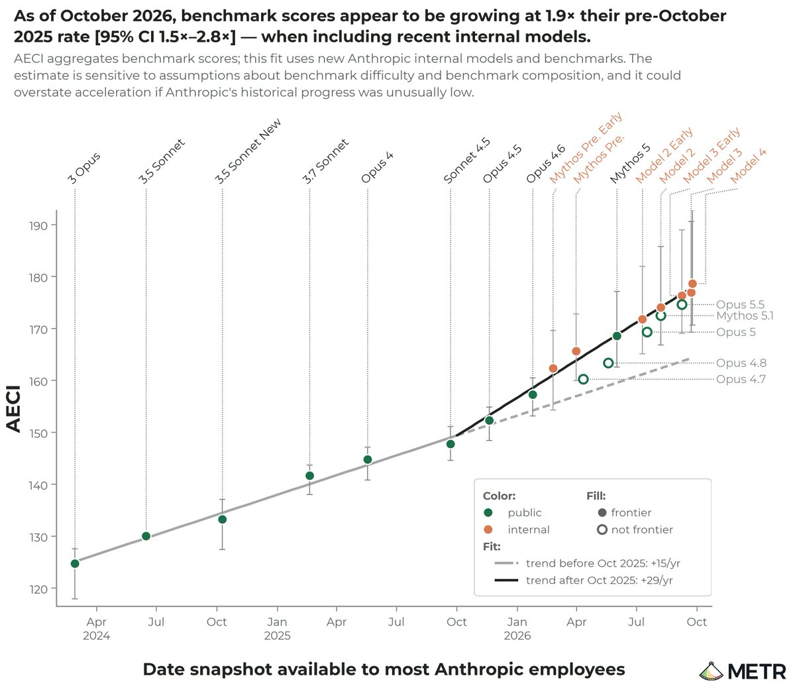
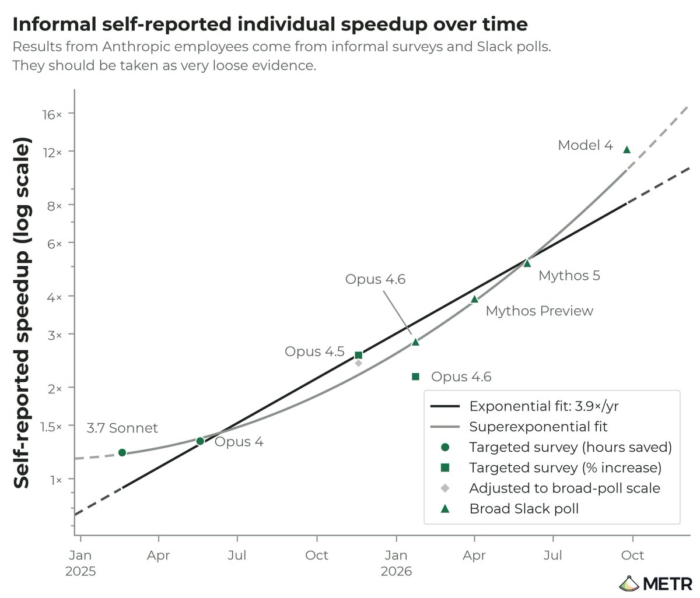
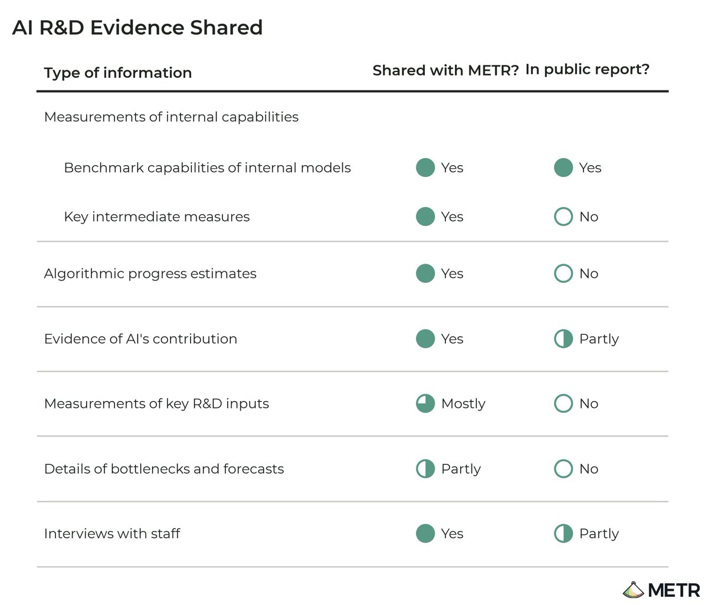
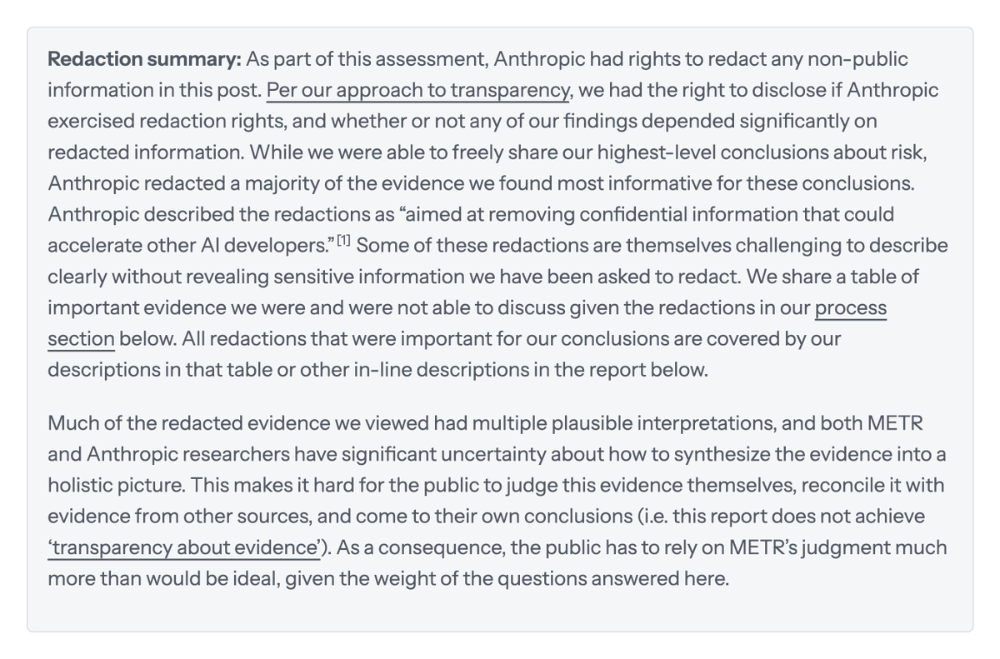
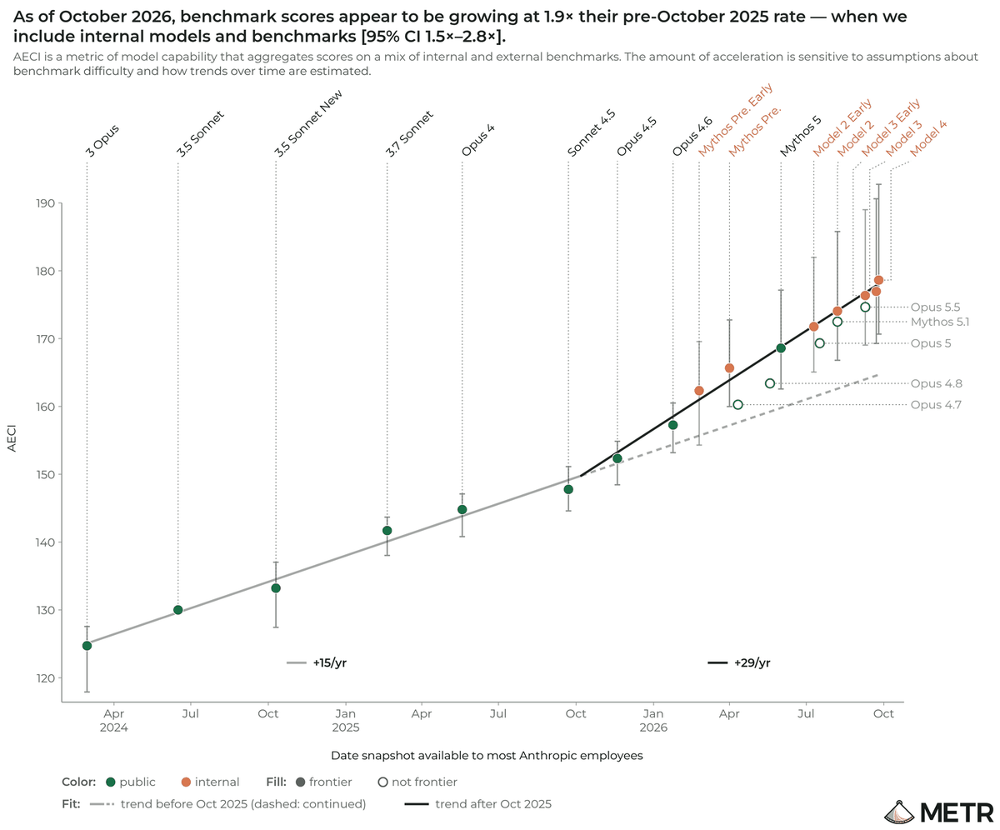

# METR：Anthropic AI 研发加速评估（2026 年 10 月）中文详细导读

> 原文：[Independent Assessment of AI R&D Acceleration at Anthropic in October 2026](https://metr.org/blog/2026-11-05-anthropic-ai-rd-acceleration-assessment/) · METR · 2026-11-05  
> 本页按报告原有章节做**逐节详细导读**（编译），保留全部关键数字、方法与限制条件；不是全文逐字翻译。文中短引号内为原文关键句。图表版权归 METR / 原作者，文末附 X 讨论。

## 开篇摘要

METR（Model Evaluation & Threat Research）从 2026-08-12 到 2026-10-29，在 Anthropic 内部做了一场**高权限访问**评估，核心问题是：AI 本身有没有在加速 AI 研发。团队投入约 2.5 个全职人力，不收 Anthropic 的钱，最终向 Anthropic 提交约 100 页完整报告；公开版里，Anthropic 删掉了 METR 认为最有信息量的大部分证据。

公开版能直接说的主观结论有三条：

1. **速度**：截至 2026-10，Anthropic 在「定义清楚的任务」上提升模型能力的速度，大约是 2024-03 到 2025-10 那段历史节奏的 **约 2 倍**；不确定区间大约 **1.3×–3×**。
2. **归因**：当前这轮加速里，**多数（METR 主观猜测约 80%）**可能来自大量用 AI 做研发；2025 年底那一波加速，非 AI 因素可能起了很大作用。加速**不是**训练算力增速变快造成的。
3. **瓶颈**：公开可见证据里，没看到未来 12 个月内会明显卡住的算法、训练算力、实验算力或数据瓶颈；因此存在「进一步能力进步 → 更快加速」的显著风险。METR 反复强调自己视角有限，可能漏了瓶颈。

公开侧最硬的数字是：自 2025-10 起，Anthropic 内部 AECI（Anthropic 版 Epoch Capabilities Index）增速约 **1.9×**（95% CI：**1.5–2.8×**），相当于过去一年的基准进步≈此前两年（约从 Claude 2.1 到 Sonnet 4.5）。稳健性检验把加速估到 **1.1×–2.9×**。

**阅读提示**：Anthropic 大量删红后，公众无法自己核对最关键证据，只能比理想状态更多地依赖 METR 的判断。本页后半部分整理了 METR、Anthropic 联合创始人 Sam McCandlish，以及研究者、中文圈对该报告的讨论。

---

## 删改说明（Redaction summary）

报告开篇就写清合同结构：Anthropic 有权删掉任何非公开信息；METR 有权披露「是否行使了删改权」「结论是否显著依赖被删内容」。

Anthropic 确实行使了删改权，并删掉了 METR「最有信息量」证据的**多数**。Anthropic 的说法是：删改「aimed at removing confidential information that could accelerate other AI developers.」（旨在去掉可能加速其他 AI 开发者的机密信息。）

METR 同意被删内容属于这类机密，但**不评价删得是否整体合理**——它认为自己不适合在公司商业利益与公众知情之间做权衡。后果是：公开报告**达不到「证据透明」**；许多被删证据有多种合理解释，METR 与 Anthropic 研究者对如何合成全局图景都有很大不确定性。

---

## 执行摘要（Executive summary）

### 评估窗口与访问

- 时间：2026-08-12 至 2026-10-29。
- Anthropic 提供了对内部 AI 研发流程的空前访问：预训练、强化学习（RL）、各域训练算力、内部模型基准、AI 提速分析、未来模型指标预测、相关员工访谈等。
- 动机：若 AI 开始显著加速进一步的 AI 开发，可能突然出现极端且有风险的能力。

### 主观风险结论（三条）

**能力进步节奏。** 截至 2026-10，在定义清楚的任务上，Anthropic 提升模型能力的速度大约是 2024-03→2025-10 历史节奏的两倍；真值落在 1.3× 或 3× 附近都不意外。对更宽、更不清晰任务的外推还有额外不确定性。

**归因于 AI。** 当前加速的多数很可能来自 Anthropic 广泛用 AI 做研发；不确定性很大，且其他原因在 2025 年末加速中很可能也扮演了重要角色。

**进一步加速的风险。** 未见明显瓶颈或强递减收益，因此进一步能力进步可能导致更快加速；也可能漏了重要瓶颈。

### 可公开描述的关键实证发现

- 自 2025-10 起，内部模型 AECI 增速约 **1.9×**（95% CI 1.5–2.8×）→ 过去一年≈两年历史进步。
- 加速**不是**训练算力规模增速加快造成的。
- 访谈与调查与「AI 使用导致能力进步节奏翻倍」相容。员工自述提速很夸张，但难解释；研发加速主要靠 AI **辅助**，而非完全自主贡献；已有「signs of life」（生命迹象）暗示完全自主贡献可能很快变大。
- 未来 12 个月未见算法、训练算力、实验算力、数据方面的显著瓶颈证据；对瓶颈状态的理解多次翻转，当前判断信心不高。
- 最能支撑风险结论的若干关键发现被 Anthropic 删红。

### 过程与局限（摘要）

- 过程：范围、设置、时间线；共享了什么；删改后不能写什么。
- 可能**低估**加速的情形：(1) 近期增速还在继续抬升；(2) AI R&D 任务进一步自动化；(3) AECI 有时低估真实世界影响。
- 可能**高估**加速的情形：(1) 非 AI 因素；(2) AECI 偏可验证任务；(3) Anthropic 早期（2023–2025）增速异常偏低。

---

## 我们对风险的主观结论

METR 另有 2026-10 文章，提出公众理解失控风险需要搞清的高层问题。本节说明：这次内部证据如何改变了 METR 团队对那些问题的主观看法。

### 能力进步节奏

「显著加速整体进步率」本身会令人意外——因为递减收益和对算力缩放的依赖，通常还需要其他投入的惊人扩张。审完内部证据后，团队仍有显著不确定性与内部分歧，但**多数参与本项目的 METR 员工**现在相信：截至 2026-10，定义清楚任务上的能力提升速度约是历史的两倍；1.3× 或 3× 都不意外。

1.9× 的 AECI 趋势（95% CI 1.5–2.8×）显著塑造了这一判断，但也可能是对基准分布过拟合，或 AECI 方法的伪影。另一方面，AECI 数据点滞后于研究加速，且偏稀疏，未必总能可靠估近期 R&D 加速。

除 AECI 外，还有**被删红**的证据让团队更认真对待≈2×；也有迹象显示加速可能**高于 2× 且随时间上升**，但若显著更高会令他们意外。

### 归因于 AI

考察过的因素包括：算力缩放、招聘、数据改进、算法发现、其他瓶颈解除等。

能**有把握**排除的一点：加速不是训练算力增速加快造成的。除此之外，Anthropic 内部也无共识，METR 也没有决定性证据。主观估计是：

1. 2025 年末加速很可能受非 AI 因素影响（许多细节被删）。
2. 猜测当前（2026-10）加速的多数（也许≈**80%**）来自 AI。判断不确定性很大，但基于多条关于 AI 贡献与其他原因的证据线。认为 AI 贡献相对重要性在上升；所考察的其他因素难以解释**持续**加速。下文关于 AI 使用提速的证据也与「大贡献」相容。

更细的「AI 对 AECI 与训练管线各阶段的累计/瞬时效应」估算被删红。

### 进一步加速的瓶颈

关键担忧是：用 AI 加速可能开始**复利**——更强模型带来进一步加速。公开描述是：未识别出清晰瓶颈或陡峭递减收益，尽管评估过程中理解多次演变，不确定性很大。因此认为存在显著风险：未来一年进一步能力进步可能导致更快加速。

---

## 关键发现（Key findings）

术语：用年倍数描述增长；用增长率之比描述「加速」。**2× 加速**＝用 1 年完成 2 年历史进步。若 AECI 历史趋势是 15 点/年，升到 30 点/年则加速率＝2。对指数增长变量，加速率＝增长率之比。

表：METR 推文配图 · AECI 趋势与加速估计 · 来源：[METR_Evals](https://x.com/METR_Evals/status/2118412205662314935)

### 自 2025-10 起，内部基准约两倍于历史增速

**Anthropic 模型 AECI 自 2025-10 起加速约 1.9×（95% CI：1.5–2.8×）。**

换言之，过去一年基准进步≈2023-10 到 2025-10（大致 Claude 2.1→Sonnet 4.5）。

该估计高于 Haiku 5.5 系统卡报的 **1.7×**，主要因为纳入了更新的未发布模型。

稳健性：换基准纳入、模型定年、模型纳入、饱和处理，加速估在 **1.1×–2.9×**。若「改进版 AECI」测到的真实演进是「无加速」或「>3×」，会令作者意外。细节见附录。

### 加速不是训练算力规模增速造成的

收到有说服力的证据，证明加速不是训练算力规模增速加快所致。进一步细节被删红。

### 访谈与调查与「AI 使用驱动翻倍」相容

相关证据线包括：访谈、自述提速、人数、代码行数、实验用量、领导层定性反思。公开可强调的有三块：

**第一，访谈。** METR 与 Anthropic 都深度访谈了许多研究员，问其工作领域因 AI 使用带来的整体加速。总体印象：估计范围很宽，但大致围绕 **2×**。部分引语（敏感细节已删）见附录。

**第二，自述提速。** 最新数据来自一系列 Slack 投票：员工用 reaction 投票估计「最新模型带来的提速」。METR 认为这只是很松的证据（低投入、样本偏）。但仍观察到自述持续上升，且水平很高（2026-10 达到约 **12×**）。

注意：个人提速≠组织级加速率。要维持输出（如模型能力）的某增长率，通常需要劳动与/或劳动生产率的类似持续增长以克服递减收益。要显著加速整体进步，通常需要这些投入显著加速。因此更关心的是个人提速的**增长率变化**，而非绝对水平。关于「何种个人提速增长率才能解释关键领域估计加速」的更细分析被删红。

**第三，自主贡献。** 目前理解是：AI 尚不能对模型训练最重要环节做出高度显著且完全自主的贡献。但研究者描述了显著「signs of life」，暗示这类贡献可能很快出现，成熟度因领域而异。

表：自述提速随时间变化 · 来源：[METR_Evals](https://x.com/METR_Evals/status/2118412212134158442)

### 未见令人信服的持续快速进步瓶颈

未来 12 个月，算法进步、训练算力、实验算力、数据方面未见显著瓶颈证据。但对不同瓶颈状态的理解随更细信息多次改变，对当前评估信心不高。若干具体瓶颈分析被删红。

### 额外被删证据：难解释，但支持持续乃至上升的加速

内部指标与方法覆盖预训练与 RL 的基准、算法效率、整体模型强度，以及算力利用率、推理效率、数据效率等。调查包括：内部指标的方法变体（花费数周，是最大不确定性来源）、相关团队对关键内部证据与加速估计的信念、训练管线其他部分是否偏估、是否对内部指标过拟合。

内部证据支持训练管线存在显著加速；部分证据暗示加速可能 >2× 且随时间上升，但解释不确定性很大。

表：管线证据示意（公开版大量涂黑）· 来源：[METR_Evals](https://x.com/METR_Evals/status/2118412189833085248)

---

## 过程细节（Process details）

### 目的与关系

METR 评估 Anthropic 内部「AI 加速 AI R&D」的程度，以及极端有风险能力可能多快出现。Anthropic 的 Responsible Scaling Policy（RSP）把 AI R&D 加速列为关键风险指标；本次评估**不特别对照** RSP 门槛，而是试图形成整体图景。

本项目始于 8 月中旬，**不同于** Anthropic 于 2026-10-15 宣布的「类员工权限」独立评估方安排。

### 三大问题与权限

十一周独立评估围绕：

1. Anthropic 内部能力增长率是否加速？
2. 加速中有多少可归因于 AI？
3. 近期是否有重要瓶颈会放缓增长或限制加速？

另有范围：审阅 Anthropic 2026-08 Risk Report 中 AI R&D 部分（单独发表）。合同最初还包括核查「能力 vs 安全」算力分配百分比。

METR 可请求任何其认为相关的信息；Anthropic 可单方面批准或拒绝。实务上常谈判折中到「有信息量、不太敏感、易共享」的数据。整体访问超出预期。本次**未**请求/获得对非公开模型的采样访问。也不是「员工式」无中介访问。

Anthropic 对报告中所有非公开信息有单方面删改权。METR 可单方面披露：审查与删改流程的存在与一般条款；是否行使删改；结论是否显著依赖被删信息；访问水平。

出于安全，评估全程在 Anthropic 设备上工作。Anthropic 提供免费 token，主要用于 AI 辅助数据分析与可视化。按惯例不收 Anthropic 付款。遵循 METR 与 AI 公司合作政策；附录有 COI 披露、合同摘录与 AEF-1 清单。

### 删改了什么

约 100 页 Full Report 试图详细回答 METR 近期提出的关键问题。公开报告能写的证据源如下（报告表）：

| 信息类型 | 是否分享给 METR | 公开报告是否描述结果 |
| --- | --- | --- |
| 内部能力测量：内部模型基准能力 | 是 | 是 |
| 内部能力测量：关键中间指标 | 是 | 否 |
| 算法进步估计 | 是 | 否 |
| AI 贡献证据 | 是 | 部分 |
| 关键 R&D 投入测量 | 大多 | 否 |
| 瓶颈与预测细节 | 部分 | 否 |
| 员工访谈 | 是 | 部分 |

表：共享与删红证据源 · 来源：[METR_Evals](https://x.com/METR_Evals/status/2118412194702598339)

因删改，公开版还无法传达：

1. 训练管线关键领域更细的加速与 AI 归因估计；
2. 算力/数据/算法贡献更细拆分（除「加速不是训练算力增速」这一关键 takeaway）；
3. 对提案中局限问题的更细回答（需更多方法细节）；
4. 未来模型指标预测。

另有若干次要删改，报告各节尽量描述。

### 关键日期

1. 08-12：开始分享机密信息  
2. 08-14：分享未删改的 8 月 AI R&D Risk Report  
3. 09-12：Full Report 初稿给 Anthropic  
4. 09-18：Risk Report Review 初稿  
5. 09-22–10-22：迭代  
6. 10-22：约 100 页 Full Report 交付  
7. 10-25：Anthropic 给出删改指引  
8. 10-26：公开报告草稿  
9. 10-27–29：Anthropic 收紧删改指引，METR 迭代  
10. 10-29：提交公开报告草稿；双方同意约 5 天延期以更仔细适配新指引  
11. 11-03：提交最终公开报告  

### 拿到的数据（摘要；详细清单被删）

包括但不限于：内部基准与 AECI、样本任务/评分标准/agent 花费；预训练与 RL 历史算法效率与整体强度、算力/推理/数据效率；人数与进度归因；多域训练算力；内部分析；各团队自述提速调查；全公司与部分研究团队代码行/PR；AI agent 推理花费随时间；自主研究贡献内部文档；约 15 次关键员工访谈（预定义宽范围，排除特别敏感主题）。少数请求因过于敏感未提供。Anthropic 还提供大量员工时间；METR 认为最密切合作的两人是 Anthropic 内部对 AI R&D 加速测量上下文最深的两名研究者。

### 算力分配核查被取消

合同原含核查 Anthropic 算力分配（尤其能力 vs 安全）。中途 Anthropic 改范围，去掉算力核查，只做 AI R&D 加速。取消时 METR 尚未对算力使用得出实质结论。Anthropic 称希望暂时聚焦风险评估，以后再回头做。

---

## 局限性（Limitations）

### 访问有限可能导致漏上下文或数据

尽管访问很深，员工级访问仍会显著加深评估。信息管道相对窄，少数数据请求被拒。若能按需读文档、观察内部讨论、做更频繁多元对话，图景会更丰富。可能因「不知道某信息存在」或「无法自己查找」而漏掉重要信息。

评估过程中，对关键数据的解释随更多上下文多次大幅改变，甚至在关键问题上多次翻转。更充分访问本可大幅加速正确解释；仍可能有因上下文不足而误读的点。

### 可能低估加速

- **错过近期进一步加速。** 增长可能在持续加速（例如双曲增长）。AECI 趋势上未见清晰证据，但有其他被删证据使之更可信。若双曲，则瞬时加速被低估，近未来加速被大幅低估。另：模型级结果只在训练完成后才观测到，观测有效 R&D 加速有约等于训练时长的滞后。
- **自动化比估计的更近。** 尚不能完全自动化训练管线实质性部分，但有 signs of life。一旦去掉人类瓶颈，可能非常迅速加速。
- **AECI 可能低估真实世界影响。** 基准与真实影响关系数据稀疏。例：数学上 ECI 增速未见大幅加速，却出现解决困扰人类数十年的 Millennium Prize 问题。真实影响可能下游于能力曲线突然跨越。

### 可能高估加速

- **非 AI 因素解释大部分加速** → 对未来高增长/进一步加速的预期应下调。
- **加速可能限于定义清楚的任务。** 证据多测易自动/用 LM 评分的「干净」任务。若相对历史，近期模型在干净任务上比在「messy」任务上增长更快，则可能高估真实影响加速（例如对 AECI 任务类型过拟合）。
- **若历史增速异常偏低，则加速数字被夸大。** 附录指出：Anthropic 模型在 2025 年末前，AECI 历史增速低于更广行业前沿，可能解释部分加速。

---

## 附录要点

### 方法：内部模型、断点、三种增长率

纳入 Anthropic 仅内部模型（公开代号）：Unreleased 2022（2022 训完）；Model 2（2026-07）；Model 3（2026-08–09）；Model 4（2026-09–10）。未来模型预测被删。

常用带单一断点的 OLS 分段线性拟合；加速＝两段线性趋势之比。默认采用标准 AECI 上最佳拟合断点（主设定约 **2025-10-07**），以在各图保持一致。

围绕三种增长率组织：历史增长率（趋势变化前）；当前增长率（2026-10）；反事实增长率（若 Anthropic 不能用 AI）。前两者可观测，反事实只能猜。需区分 AI 带来的**瞬时加速**与**累计加速**（例如自 2025-10 以来总进步中 AI 占比）；访谈/文档常隐含讨论累计加速，而累计通常低于瞬时（因 2025 非 AI 加速因素 + AI 影响随时间上升）。

Full Report 用简单会计框架组织间接证据（箭头表示函数依赖：如预训练强度＝算法、数据质量、训练算力的函数；RL 含预训练以外全部贡献）。公开版中相关用法均被删。分析有可复现 notebook/dashboard。

### AECI 附录：主估计与稳健性

用 Epoch 公开代码估各模型 AECI；分层 bootstrap 得 95% CI。每个模型有多快照（日期与分数不同）。公开发布模型：取公开发布快照，日期取「多数 Anthropic 员工可用」日。从未发布的：取获大量内部使用的快照及多数员工可用日。用内部可用日而非公开发布日，以便与未发布模型苹果对苹果；一般显示略高加速（因近期模型在公开发布前内部多留一阵）。

趋势拟合对前沿上每个快照等权 OLS。趋势 CI 只反映各模型 AECI 分数不确定性，不含「纳入哪些模型」的抽样不确定性。外生施加「恰有 1 个断点」；主设定断点 2025-10-07；稳健性检查保持该断点以便可比。

**链接函数稳健性（加速 1.1×–2.9×）：**

| 链接函数 | 任务难度分布直觉 | 加速 | 样本外 R² |
| --- | --- | --- | --- |
| 标准 logistic | 对称、指数尾 | 1.9×［1.5–2.8］ | 87.2% |
| Probit | 易难两侧尾更小 | 1.8×［1.3–2.7］ | 87.1% |
| Cauchit | 两侧尾更大 | 2.8×［2.0–4.1］ | 86.1% |
| Complementary log-log | 仅易题大尾 | 1.1×［0.8–1.5］ | 87.1% |
| Log-log | 仅难题大尾 | 2.9×［2.1–4.9］ | 86.9% |
| 学习链接（Stukel） | 两尾长度由数据估 | 2.6×［1.8–4.1］ | 87.0% |

拟合质量相近（cauchit 略差）；继续用 logistic，因它是 Epoch/Anthropic 默认。

快照选择：标准 1.9×；仅最高快照 1.9×；仅首次快照 **2.2×**；某子集（删红原因）1.9×；全部快照 1.9×。

基准选择：标准 1.9×；去掉视觉基准 **2.2×**；仅 Claude 标为与 AI R&D 相关的基准 2.0×；去掉平均随 AECI 上升而下降的基准 1.9×；去掉 logistic 拟合 R²<50% 的基准 1.9×；达 85% 后停用该基准（饱和稳健）1.9×。

正则：标准 1.9×；L2÷10 →1.9×；L2×10 →**2.1×**；无正则 1.9×；对线性时间趋势重定心 L2 →1.9×。

纳入非 Anthropic 模型时，估计加速更低（约 **1.4×**）：历史趋势多来自非 Anthropic，当前趋势多来自 Anthropic。两种合理解释：(1) Anthropic 2025 年处于次前沿，历史进步被低估 → 1.9× 偏高，1.4× 更准；(2) 若 Anthropic 相对少做基准优化，历史趋势可能因早期点更过拟合而偏高 → 1.4× 偏低，1.9× 更准。

相对「Mythos Preview 一次性跳升后回到旧趋势」假说：纳入新内部模型后，**永久斜率变化**看起来更可信。

与公开估计对比：相对 Haiku 系统卡 1.7×，主差是纳入近期仅内部模型；相对 ECI，主差是趋势只取 Anthropic 模型 + 纳入近期内部模型。

**Model 4 在其测试的全部 AECI 基准上 >50%。** 9 个月前 Opus 4.6 仍有许多 <50% 的基准。难题不足令作者对现在与未来测量 AECI 的能力略感紧张。15 个 Model 4 基准中多数在 log-odds 空间看起来 reasonably linear；3/15 明显平坦或凹。去掉这 3 个可疑基准后重估，Model 4 从 178.6 升到 179.7（+1 点）——弱证据支持「肥尾导致低估加速」，幅度不大。

典型任务 token：内部基准约 2.5M in / 72k out；agentic coding 约 10M in / 94k out。粗比 Epoch/METR 公开基准花费更高。猜测若进一步缩放推理 token，各模型 AECI 可再升若干点，且跨模型回报类似 → 加速估计大致不变（未深挖；近期模型可能有更好 token 缩放）。

基准加速与真实影响：若真实影响是基准分数的凸函数（阈值），AECI 低估真实加速；若 AECI 只覆盖能力子集且真实影响对这些能力递减，则可能高估。作者自信至少存在温和的基准分数增长加速，并认为 AECI 加速未必干净映射到真实影响加速。

### AI 提速证据附录

定义 AI speedup＝有 AI / 无 AI 的产出比（产出常难测）。结论：(1) 有高提速证据，精确量高度不确定；(2) 完全自主 AI R&D 贡献目前不是整体进步的大头，但近未来可能是。

Claude 对访谈引语是否支持「其领域因 Claude 带来 >2× 加速」的分类：Yes 2；Leans yes 3；Borderline/unclear 4；Leans no 0；No 2 → 轻度偏向 2× 或以上。

公开引语示例（敏感细节已删）：

- Researcher A：可 endorses >2×；内部观最大效应是模型加速；AI 加速大于其他所有效应；现在只瓶颈于想法与算力、不再瓶颈于代码；可 endorses「1 年 >2 年进步」，4 也不 crazy；80% 效应是想法到实验时间缩短……
- Researcher B：「很难看出我不是 3× 更高效……最简单解释是 Claude。」
- Researcher K：招聘可能是最大原因 → No  
- Researcher L：猜 15–20% 因 AI；不信自述生产力；偏好某非 AI 因素解释 → No  

完全自主贡献的 signs of life 来自：自动化训练管线不同部分的多次访谈；不同部分自动化程度内部报告；相关管线中人类/AI 构建任务占比定量分析。细节被删。

### 对抗稳健性、COI、合同、AEF-1

对抗稳健：多数数据经两名技术员工；另访谈约 15 人（许多由 METR 自选），未发现主联系人与受访者间不一致。多数分析依赖 Claude（数据收集、文档、METR 自身分析）；对照人类访谈未见系统偏差迹象。认为 Anthropic 主动误导的可能性极低；更大访问可提高对抗稳健度。

COI：项目开始时适用 v1.0 政策。一名参与者当时在与 Anthropic 谈可能职位（后拒 offer），且作为前员工持有竞争对手股权 → 其纳入评估的工作须由无利益冲突成员彻底核对并承担准确性责任。更新后政策（2026-10-09 后）对此类情况将直接要求回避。无人持有 Anthropic 股权。

非正式压力：评估自愿；METR 会考虑产出如何影响未来合作意愿。尽量把「因删改导致的局限」讨论聚焦在影响核心结论与不确定性传达的情形；避免过细过程描述妨碍探索性合作。Risk Report Review 因 Anthropic 反馈做过大量清晰度编辑；个别反馈显得过于强硬，Anthropic 接受了相关反馈。认为最终评估未被显著扭曲。

合同摘要：独立评估 AI 系统自动化/加速 AI R&D 的程度；Anthropic 提供约定访问、对接人、协助调查访谈，可拒不成比例或未过信息审查的请求但须说明并尽量给替代；交付 Full Report（未删改给 Anthropic）、公开主张（经删改流程）、（计划中的）METR 内部轻删版；无双向付款；独立性条款。

AEF-1：查询未发布模型未请求；充分计算资源与时间（从 4 周延到 11 周）；无结果或有条件补偿；方法自主；编辑控制在 METR，但 Anthropic 控制可写入公开的非公开信息；因删改，**未能**分享足以独立复核结果的方法细节；系统方有权删改非公开信息；已披露删改权；未建立 responsible disclosure policy（清单项 5.4 标 No）。

---

## X 上的相关讨论

检索窗口约 2026-11-04 起。时间均为北京时间（Asia/Shanghai）。按立场分组；只收录能核对到的帖子，不编造。点赞/浏览数为抓取时快照。

### A. METR 官方线程

- **@METR_Evals** · 2026-11-06 02:36 · [原帖](https://x.com/METR_Evals/status/2118412183860351084)  
  自 8 月起用 Anthropic 内部信息评估「AI 是否在加速 AI 开发」，现发布风险评估结果摘要。约 3444 赞 / 82 万展现。

- **@METR_Evals** · 同线程 · [删改说明](https://x.com/METR_Evals/status/2118412194702598339)  
  向 Anthropic 提交约 100 页完整报告；公开版删掉了最有信息量证据的多数，公众只能比理想状态更多地依赖 METR 判断。配删改对照图。

- **@METR_Evals** · [三条主观结论](https://x.com/METR_Evals/status/2118412196770398494)  
  (1) 定义清楚任务上约 2×（1.3–3×）；(2) 多数加速现可能由 AI 用于 AI R&D 驱动，但不确定，2025 末非 AI 因素大；(3) 未见清晰瓶颈/强递减，未来 12 个月有进一步加速可能。

- **@METR_Evals** · [AECI 1.9×](https://x.com/METR_Evals/status/2118412205662314935) · 配趋势图  
  自 2025-10 AECI 增速 1.9×［1.5–2.8］；分析选择会影响估计；基准与真实能力映射仍不清。

- **@METR_Evals** · [非算力](https://x.com/METR_Evals/status/2118412208153694480) / [访谈与自述](https://x.com/METR_Evals/status/2118412212134158442) / [无瓶颈](https://x.com/METR_Evals/status/2118412213832863884) / [可能低估/高估](https://x.com/METR_Evals/status/2118412216500445397) / [与 10-15 评估方项目不同](https://x.com/METR_Evals/status/2118412219256054091) / [算力分配试点被取消](https://x.com/METR_Evals/status/2118412220900249834)

- **@METR_Evals** · 另发对 Anthropic 2026-08 Risk Report「自动化 R&D 风险」节的[审阅线程](https://x.com/METR_Evals/status/2118417772774580623)：同意截至 7 月中直接自动化 R&D 的灾难风险仍低；但认为公开报告**低估了**「已越过加速阈值」的合理可能性；即便约 2× 加速，也多半达不到 Anthropic 灾难情景所要求的那种水平。

### B. Anthropic 侧回应

- **@Sam_McCandlish**（Anthropic 联合创始人 / Responsible Scaling Officer）· 2026-11-06 03:16 · [长帖](https://x.com/Sam_McCandlish/status/2118422266669371519)  
  约 2559 赞 / 37 万展现。要点：能力进步速度是安全最重要问题之一；METR 给公众提供了独立外部视角。Anthropic 给了未发布模型基准、进度估计、研究员访谈，METR 结论完全独立。许多结论与他一致：AI 在加快研究，但难说清多少；AI 尚不能独立做训练最重要贡献，但默认速度可能进一步加快。承认删得多、更难核查；理由是公开「到底什么在驱动加速」既商业敏感，也等于给别人加速路线图，会让 METR 担心的风险更严重——认为取舍正确，仍在评估利弊。未来几周 Anthropic 将发自己的进度报告、对照 RSP，以及新的安全措施。本工作早于且独立于 10-15「嵌入式第三方评估方」承诺。

- **@Sam_McCandlish** · 2026-11-06 07:42 · [回复质疑](https://x.com/Sam_McCandlish/status/2118489153147183237)  
  未删内容会让别人加速研究；认为安全含义重于透明收益；并指向嵌入式第三方评估方模式作为更长答案的一部分。

（检索窗口内未见 @AnthropicAI 官方账号直接转发本报告的帖；主要公开回应来自 Sam。）

### C. 研究者 / 评论者：认可主线，但强调外推与透明度

- **@DavidSKrueger**（Mila / 前 DeepMind、UK AISI）· 2026-11-06 05:33 · [帖](https://x.com/DavidSKrueger/status/2118456622175727911) · 130 赞  
  认为「AI 自动化 AI R&D → 可验证任务进步偏离数年前趋势」大体为真；但 Anthropic 删了大量相关证据，只能信 METR。关键分歧在于：可验证任务能外推多远。戴对抗帽子时会说：独立评估方现在在帮公司造势，却方便地不能放出真正证据——观感不好。

- **@Thom_Wolf**（Hugging Face 联合创始人）· 2026-11-06 07:05 · [帖](https://x.com/Thom_Wolf/status/2118479815221096785) · 74 赞  
  报告偏「向内看」：数实验室算力、招聘、内部数据，再把约 80% 加速记到 AI。从外部看，实验室正成为资金的 Schelling point，把钱再分配给它们为加速自身而创造的生态；最好的数据与 RL 环境公司甚至比实验室更早知道模型会在哪失败。很多「AI 加速 AI R&D」发生在实验室外。

- **@fleetingbits** · 2026-11-06 07:28 · [14 点长帖](https://x.com/fleetingbits/status/2118485551678648351) · 38 赞  
  AECI 证据看起来有说服力；被删部分可能是算法效率随时间的信息；加入其他厂商历史模型后加速降至约 1.4×；提速大致从 Opus 4.5 起（编码自动化）；呼吁实验室定期发布内部 ECI 与 research agent 花费；提醒「加速≠世界末日叙事」。

- **@deredleritt3r** · 2026-11-06 03:19 · [帖](https://x.com/deredleritt3r/status/2118422855549358552) · 418 赞 / 2.9 万展现  
  聚焦内部 Model 4（9–10 月训完）、AECI≈178.6（与系统卡 AECI 刻度可能不同；Opus 5.5≈174.5、Mythos 5.1≈172.5）；指出 Anthropic「dramatic acceleration of AI R&D」披露的证据来源；强调 signs of life。配 AECI 图。

表：讨论帖配图 · 来源：[deredleritt3r](https://x.com/deredleritt3r/status/2118422855549358552)

### D. 中文讨论

- **@dotey（宝玉）** · 2026-11-06 06:12 · [长帖](https://x.com/dotey/status/2118466539510960161) · 29 赞 / 1.2 万展现  
  系统中文复述报告：2×、约 80% 归 AI、无瓶颈、1.9× AECI、访谈与 12× 自述、大半证据涂黑、算力核查取消、与 Sam 回应对照。强调「进步加速别读成模型聪明一倍」。

- **@NFT_Chen** · 2026-11-06 04:38 · [帖](https://x.com/NFT_Chen/status/2118442948060934540) · 46 赞 / 2.8 万展现  
  强调 Model 4 AECI 178.6、1.9×、递归自我改进叙事；语气比报告本身更强（报告写的是「signs of life」与高度不确定，不是「已经启动」）。

- **@0xLogicrw（思维怪怪）** · 2026-11-06 12:36 · [帖](https://x.com/0xLogicrw/status/2118563210609758421)  
  把报告与 Anthropic IPO 招股书中「自我加速研发安全门槛」预警并读；提到 METR 对 8 月风险报告的审阅认为公开表述可能低估越过阈值的合理性。

- **@trymorewz** · 2026-11-06 13:32 · [帖](https://x.com/trymorewz/status/2118577269056720995)  
  提醒 1.9× 是基准分数增速，不能直接换算真实任务能力或归因于 AI；公开版删了大量证据。

- **@UFO2002616** · 2026-11-06 08:22 · [帖](https://x.com/UFO2002616/status/2118499344898998486)  
  批评 Anthropic「对外劝缓、对内油门」；指出 Model 4 在 15 项 AECI 基准均 >50%，METR 担心基准已不够强。

- **@dongqingtry** · 2026-11-06 09:07 · [帖](https://x.com/dongqingtry/status/2118510479236903322)  
  「自己请来的裁判交出难堪报告」角度：能力提升或已翻倍，加速大头可能来自 AI 做研发。

- **@nirvanaaa00 / @wellwue / @bufcapy / @AlexZ89757 / @shanfengfengybq** 等亦有中文摘要或短评，主线数字与上文一致；部分强调「证据涂黑 → 只能信评估方」。

### E. 其他英文转述

- **@shipfrontierai**、**@theCodingBird**、**@robshocks**、**@panera4**、**@anaveentalks** 等多为报告三点结论的转述；有人直接把叙事接到「递归自我改进已经发生」。这些是发帖人解读，并非 METR 原文措辞。

---

## 来源与版权

- 报告原文与图表：© METR，[metr.org 原文页](https://metr.org/blog/2026-11-05-anthropic-ai-rd-acceleration-assessment/)
- 本页为中文逐节详细导读（编译），非授权全文译本；数字与结构尽量忠实，短引保留英文原句。
- X 帖文版权归原作者；本页仅作讨论索引与观点复述。
- 页面制作：归藏阅读页 · 部署于 `op7418/reading-pages`
